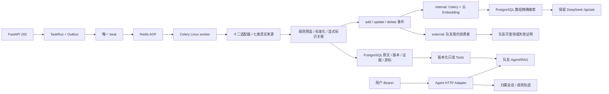

# 后端架构与可靠性边界

## 数据与迁移

DataSource 配置/游标；Document/DocumentRevision 原始载荷、正文完整性、时间、元数据与版本；VulnerabilityAlias/VulnerabilityDocument 显式多对多关联；Evidence 原值、引用、字段状态和方法；TaskRun/TaskStep/Outbox 任务与投递；KnowledgeEvent 操作、租约、重试；EmbeddingChunk 文档/hash/偏移/模型/维度；Conversation/ConversationMessage 归属与有限历史；AccessToken 仅 hash；AgentInvocation 请求去重/预算/耗时/轨迹。VerificationProbe 只验证 beat，不是业务。

当前迁移头 0005_document_invalidation，本轮新增 0004/0005，不修改已执行迁移。此前 0003 保留内置语义表。0004 前做了 pg_dump custom 备份并用 pg_restore --list 核验（output/pre0004.dump）；0003 前备份 output/semantic-pre-migration.dump。备份位于本机忽略目录，未变更 PostgreSQL 镜像/主版本/卷，未进行数据清空或破坏性降级。

## 事务、任务和网络

API 的任务/outbox 同事务。beat 每 5s 补发待投递任务并调度启用来源，worker 行锁/租约/活跃唯一索引保证至少一次投递不会重复写结果；过期租约与三次有限重试恢复。采集 HTTP 在写事务外；记录、版本、漏洞别名、证据、事件、游标、成功状态一起提交。跨来源漏洞实体写入顾问锁串行化，游标仅成功入库后推进。

来源端点/路径固定白名单、不跟随重定向、保留 TLS、限制响应大小；Redis 分布式来源限速，有限超时/重试。OSV 包游标，NVD 固定修改窗口+关键词+offset，arXiv 更新分页/watermark，Crossref cursor，RSS 条件请求，官方规范/法规固定目录。定义与内容完整性限制见 SOURCE_COVERAGE；采集失败保留稳定 HTTP/network/processing 码，不记录含凭据的异常。

API/worker/beat 共用非 root 镜像；Compose 唯一 beat、PostgreSQL 持久化卷、Redis AOF、端口仅本机。Docker 运行和数据重启已实际验证。部署多机时仍须单调度、共同限速及访问网络策略，不能仅复制多个 Compose beat。

## 关联与证据

文档 source_id+external_id 固定身份，hash 控制不可变历史；不同 CVE 在文章中各自关联，权威漏洞记录明确声明的别名才桥接。无标准 ID 用保守局部指纹，不按标题相似误合并。真实与演示参与唯一约束。多方原文与证据保留，聚合严重度标历史最高来源值，不能隐藏当前来源冲突。

结构化源字段为 source_reported，外部回写为 external:provider，保留 extraction_method/review_state。摘录匹配原文只证明出处，不证明模型推理；model 回写仍 pending_review。引用允许同范围当前版本的其他文档，论文关联须证据，不基于主题相近自动确认。POC 只元数据。逻辑删除保留历史，当前检索失效、产生 tombstone；不会在下一采集静默恢复。

## Agent 与索引所有权

普通用户 token 有到期/撤销及 owner；只读 Tool 和写入消费者分离；管理接口保留兼容。外部请求不跟随重定向，HTTPS 或明确开发宿主机地址，有限响应/超时/版本检查。预算、幂等与同会话并发在数据库限制；后端是会话唯一保存方。轨迹由 Agent 上报并经结构校验/脱敏，不记录私有思维链。

INDEX_PROVIDER 指定唯一消费者。internal 只有真实云端向量可入库，当前 PostgreSQL 数组执行精确余弦，不称 pgvector；旧版本留审计，搜索只当前/未失效/同范围/模型维度匹配。external 独占 15min 租约，回调必须再查询队友 verify，当前 doc/hash/范围与真实 queryable 或 removed 一致才确认，不能仅凭 index_id。确认时 document→event 锁顺序防并发换版本；失败/过期、当前事件重放和逻辑失效均有测试。

旧 DeepSeek `/qa/ask` 与新 `/agent/query` 分开，QA_PROVIDER 可明确切旧问答 provider，不删除密钥；内置语义不可用明确标 keyword/keyword_fallback。无 Agent 服务 503，没有生产测试替身或假回答。

## 尚需联合完成

云端真实语义索引/增长性能、队友真实 Agent 多轮与跨文档推理、独立标注质量/召回和持续监测 SLA；前端、知识图谱、合法资产匹配与扫描不在本轮交付。当前缺 Embedding、缺外部 Agent，真实模型答案与语义召回指标不编造。详细实测见 VERIFICATION。
