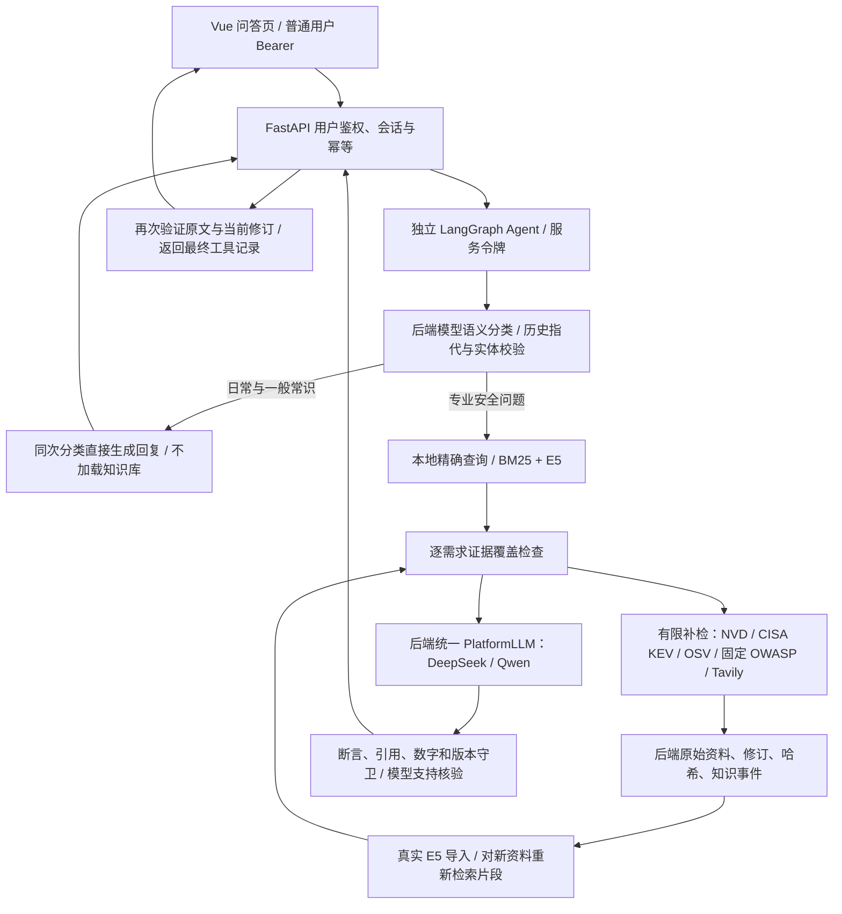

# 平台模型与动态安全情报 Agent（2026-10-12）

## 当前架构

live 模式每条请求先调用模型进行结构化语义分类；日常交流、情绪表达、算术和一般常识在同次分类中直接回答，不加载知识库或调用工具。专业与否不由知识库是否命中决定。“你好 + CVE”仍进入专业路径；分类失败是模型错误，不能转成资料不足。CVE、包生态、包名、版本来自用户明确输入；明确指代可沿用用户历史中的 CVE，助手历史不作为事实来源。初次精确查询或混合检索及补检由受控代码决定，模型需求辅助覆盖核查，执行记录来自真实调用。旧句式匹配仅保留于显式 offline/mock 回归模式。

### 密钥与模型

普通用户仅需要平台用户凭证。供应商密钥由业务后端读取，默认 `LLM_PROVIDER=deepseek`、`LLM_MODEL=deepseek-flash`；Agent 使用 `RAG_LLM_TRANSPORT=backend` 和内部服务令牌。前端、同步 worker、Agent 默认平台链路均不获得供应商密钥。

同一后端 Provider 也服务原有 `/qa/ask`，避免两套供应商配置。消息生成、可信 System、会话消息、JSON格式、超时重试、错误和实际 usage 统一处理。BYOK 和平台对外 API Key 签发不在本阶段实现。聊天模型配置与固定 E5 嵌入模型分离，换聊天模型不重建向量库。

当前接口声明 `json_object=true`、`server_tool_workflow=true`、`native_tool_calls=false`：这是当前平台适配层的传输能力。工具通过受控工作流执行；不声称供应商原生工具均已适配。

## 会话异常诊断与修复

本机旧普通用户令牌于 2026-10-11 14:01:03（北京时间）过期。对实际 `/api/v1/agent/sessions` 请求返回 `401 invalid_user_token`；当时前端一次读取后仍保留失效令牌。后端按 token 哈希、撤销标志和 UTC 过期时间检查是正常的。此次问题发生在模型调用之前。

现增加真实 `/auth/me`、`/login` 用户授权路径、草稿保留和本地有效授权重新读取。此版本采用管理员签发的短期用户令牌，未实现账号密码注册、找回密码或统一身份登录。生产用户 onboarding 仍由团队部署时提供，前端不能签发自己的凭证。

只有明确的用户凭证错误会触发重新授权。平台错误与登录错误分开：供应商 Key 错误为 502 `platform_model_auth_failed`；限流为 503 `platform_model_rate_limited`；超时为 504 `platform_model_timeout`。内部服务凭证错误转换为平台内部错误，不能冒充用户过期。完整应用的公开错误格式为 `{error:{code,message},request_id}`；内部模型失败用 `{detail:{code,attempts}}` 保留实际尝试次数。

## 证据与补检

| 工具 | 实际能力 | 边界 |
| --- | --- | --- |
| exact_lookup | 本地标准 CVE 精确匹配 | 硬过滤不放宽，不换成相近编号 |
| hybrid_search | BM25 + 真实 E5 向量、RRF | 相关性由模型另查；召回不等于结论支持 |
| related_evidence / get_assertions | 明确编号或产品关系、原始字段 | 一跳关系不声称攻击链，多份同源片段不算独立交叉证明 |
| nvd_lookup | NVD API 2.0，精确编号，真实评分/原始 CPE | 6秒本地及Redis限流；不同CVSS版本、评分主体保留 |
| kev_lookup | CISA 官方 KEV JSON；必要时官方 GitHub 镜像 | 查不到条目不证明没有在野利用 |
| osv_lookup | 明确包生态、包名和版本的 OSV API | 包实体再次核对；最多8条，分页未全量展开 |
| knowledge_lookup | 固定的 OWASP 过度代理、提示注入、数据投毒正文 | 不支持任意 URL，也不是全网搜索 |
| web_search | 固定 Tavily 服务、自然语言查询、最多3个网页结果 | 必须另配后端搜索Key；vendor正文只标partial，摘要summary，不声称独立抓取或全文核验 |

外部结果先走后端真实 `RawRecord → DocumentRevision → KnowledgeEvent` 管线，再用 UUID、hash、scope 核对后导入真实索引。OWASP/OSV 导入后对新资料做片段检索，不默认拿开头两段作答案。动态内部 DataSource 关闭定时调度；它不代表通用采集界面已支持 KEV/OWASP 任意来源。

最多初次检索加两轮补检；默认6次模型预算（含首分类）、10次工具上限，还受后端请求限额约束。总查询时限不超过25秒，官方 HTTP 共用8秒截止，通用搜索另限5秒；瞬时失败最多重试一次，429不立即重试。无新证据时先检查未尝试的通用搜索，预算不足或临近截止时终止。成功缓存15分钟（OWASP 1小时、Tavily 5分钟），保留原核查时间，不改成当前时间。

检索后没有来源时，稳定安全概念可以使用 `general_explain` 并固定标注“模型通用解释；未经过来源核验。”，公开 `retrieval_mode=llm_unverified/status=partial`，不带引用、漏洞编号或已支持的证据覆盖。具体漏洞、版本、CVSS、KEV、官方修复及时效事实不得进入该路径。`RAG_ALLOW_UNVERIFIED_CONCEPTS=false` 可关闭这一回退。搜索Key缺失与来源确实无命中是不同状态。

逐需求状态为 `supported/partial/conflicting/missing`，多 CVE 独立归属，最多40个需求。候选资料覆盖与最终生成支持分开检查。补检后重新计算缺失字段，避免已经找到了仍提示“未找到”。同分同向量的不同评分主体及同一 KEV 条目的部分转载不判为互相矛盾；原始记录全部保留。有真实数值差异时不平均、不自选最高分。

CPE AND/OR/negate、OSV版本范围尚未实现完整求解，保留原条件并标注适用性未判定。仅有补丁参考链接时不算实际修复措施已验证。采集、来源更新、核查和缓存时间分别保留；固定知识网页不能证明覆盖所有“最新”安全情报。

## 前后端接入契约

| 方向 | 接口 | 认证与字段 |
| --- | --- | --- |
| Vue → 业务后端 | POST `/api/v1/agent/query` | 普通用户 Bearer；`query/session_id/is_demo`；可选幂等键 |
| Vue → 业务后端 | GET `/api/v1/auth/me` | 普通用户 Bearer；返回 `owner_id/authenticated`，禁止缓存 |
| 业务后端 → Agent | POST `/v1/query` | `AGENT_SERVICE_TOKEN`；现有V1、历史和限额 |
| Agent → 平台模型 | POST `/api/v1/internal/llm/complete` | `X-Agent-Token=AGENT_TOOL_TOKEN`；固定purpose、payload、尝试/时间/答案限额 |
| Agent → 官方情报 | POST `/api/v1/internal/intelligence/lookup` | `X-Agent-Token=AGENT_WRITE_TOKEN`；固定tool及相应实体字段，不能提供URL |
| Agent → 后端资料/索引 | 原有读、claim、ACK、verify | 原有读写令牌、UUID/hash/is_demo范围保持 |

现有 `answer/sources/evidence/tool_trace/cve_ids/coverage/partial_errors` 保持。新增**顶层可选**字段 `question_type/requirement_coverage/retrieval_summary/limitations`。`requirement_coverage[].evidence_ids` 是公开 evidence 数组的 **1-based数字字符串**，不是内部RAG ID；missing必须无引用，其余状态必须引用实际存在的证据。后端再次核对每个原文摘录的修订、hash与定位。

运行副本为 `reports/local/integration/{frontend,backend}`，均由 Git 忽略。可携带增量分别位于 `integration/frontend_patches/dynamic_agent_v1.patch` 与 `integration/backend_patches/dynamic_agent_v1.patch`。这两个补丁从本阶段已有整链基线导出，不能随意对其他版本重复应用。对同学的新提交应先三方合并；不要覆盖整个目录。Agent实现位于正常跟踪的 `packages/rag_agent`。

本轮语义分类与搜索增量分别位于 `integration/backend_patches/semantic_intent_v1.patch`、`integration/frontend_patches/semantic_routing_v1.patch`，基于dynamic阶段导出；后端还包括 `docs/web_search.md` 配置说明。运行与新验证见 [语义路由验收](semantic_routing_validation.md)，此前记录见 [动态阶段验证](dynamic_agent_validation.md) 和 [小型评测口径](dynamic_evaluation.md)。
